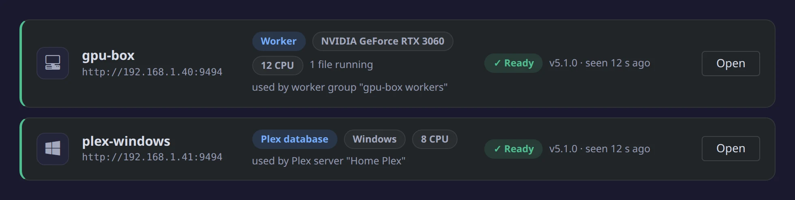

A **node** is another machine that helps the app. The app keeps the queue, the schedules, your server tokens and
every write to your servers. A node runs the heavy step it is handed and sends the result back.



## Do you need one?

You need a node if any of these is true:

- Your GPU is in a different machine from the app, or you have GPUs in more than one machine. Use a **worker node**.
- Plex runs on another machine and you want Intro & Credits markers, chapter thumbnails or loudness in it. Use a
  **Plex database node**. Previews alone don't need one: they only need Plex's config folder mounted.
- Plex is installed on Windows without Docker. Use a **Plex database node** for Windows. Docker Desktop can't open
  Plex's database safely through a Windows folder mount.

If the app runs on the same machine as the GPU and Plex, you don't need a node.

## Two kinds of node

- **Worker node:** lends its GPU or CPU for previews, Intro & Credits detection and loudness. Run it on any machine
  that can read your media. It never gets a server token and writes nothing outside its own temp folder.
- **Plex database node:** runs on the machine Plex runs on and opens Plex's database there. It runs in Docker or
  natively on Windows.

One container on the Plex machine can be both.

## Set up a worker node

1. On the other machine, start the app's image, the **same tag** as the app, with `MODE=node`. Mount your media
   read-only and pass the GPU the same way you pass it to the app:

   ```bash
   docker run -d --name media-preview-node -p 9494:9494 \
     -e MODE=node -e NODE_NAME=gpu-box -e PUID=1000 -e PGID=1000 \
     --device /dev/dri:/dev/dri \
     -v /path/to/media:/media:ro -v /path/to/node/config:/config \
     stevezzau/media_preview_generator:latest
   ```

   For NVIDIA, use `--gpus all -e NVIDIA_DRIVER_CAPABILITIES=all` instead of `--device /dev/dri:/dev/dri`. The node
   prints its key once in `docker logs`.
2. In the app, open **Settings → Nodes → Add node**. Enter a name, its address (`http://gpu-box:9494`) and its key,
   then click **Connect**.
3. Click **Next: where it sees your media**. Map each library's folder to the folder the node sees, click **Test
   access** (it checks real files from each library), then click **Save**. You can change the mappings later on the
   node's **Media** tab.
4. In **Settings → Workers**, add the node's GPU or CPU to a worker group. Its devices are listed under the node's
   name.

Update every worker node to the same tag whenever you update the app. Until then it says **Update needed** and gets
no work.

## Set up a Plex database node

- **Plex in Docker, or on Linux, unRAID or a NAS:** run the `ghcr.io/stevezau/plex-marker-agent` image beside Plex
  with Plex's config folder mounted. The [compose file and settings](https://github.com/stevezau/media_preview_generator/blob/dev/nodes/plex-db/README.md)
  name the current tag.
- **Plex installed on Windows:** download `PlexDbNode-windows.zip` from the newest **Plex database node** release on
  the [Releases page](https://github.com/stevezau/media_preview_generator/releases). Unzip it and, signed in as the
  Windows user Plex runs as, run `powershell -ExecutionPolicy Bypass -File .\install.ps1`. If Plex runs as a service
  or starts before anyone signs in, add `-AtStartup` (that user must be an administrator), plus `-AddFirewallRule`
  when the app is on another machine. With the app in Docker Desktop on the same PC, the node's address is
  `http://host.docker.internal:9494`. See the [Windows node's README](https://github.com/stevezau/media_preview_generator/blob/dev/nodes/windows/README.md).

Then add it under **Settings → Nodes**, and pick it in **Servers → your Plex → Edit → Connection → Plex database**.
A Plex marker agent from before nodes moves to the Nodes page on upgrade and keeps working.

## More detail

The [Remote nodes guide](guides.md#remote-nodes) covers every node state, updating and removing nodes, one node with
both roles, and running a node behind a reverse proxy. Environment variables are in the
[reference](reference.md#nodes).
